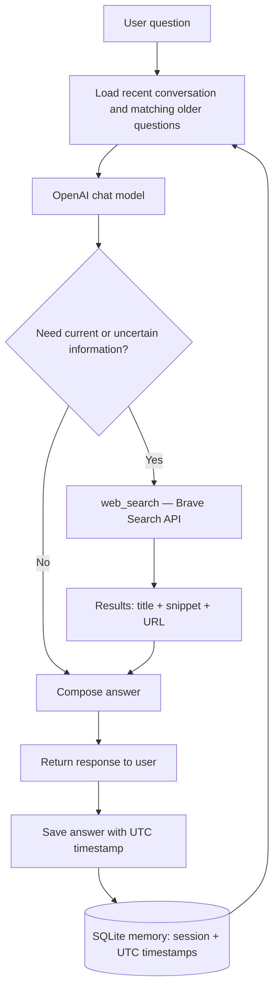

<div align="center">

# 🔎 One-Tool Web Search Chat Agent

### Search when needed. Remember the conversation. Explain what the sources support.

**A lightweight Python AI assistant that combines OpenAI, Brave Search, and timestamped SQLite memory — with exactly one model-callable tool.**

[](https://www.python.org/)
[](https://platform.openai.com/)
[](https://brave.com/search/api/)
[](https://www.sqlite.org/)
[](#license)

[Quick Start](#-quick-start) · [How It Works](#-how-it-works) · [Demo](#-example-conversation) · [Design](design.md) · [Testing](#-testing)

</div>

---

## 🎯 The problem

A typical chatbot faces three practical challenges:

- **Freshness:** internal model knowledge may be outdated.
- **Latency and cost:** searching for every question wastes time and API calls.
- **Continuity:** conversations lose value if the assistant cannot recall *what was asked and when*.

This project is a deliberately small answer to those challenges: **one search tool, selective tool use, and local memory with UTC timestamps.**

## ✨ Features

| Capability | How it works |
|---|---|
| 🌐 **Selective web search** | The LLM calls Brave Search for recent, uncertain, obscure, or disputed facts instead of searching every time. |
| 🔗 **Source-aware answers** | The agent receives search-result titles, snippets, and URLs; it is instructed to link sources and acknowledge uncertainty. |
| 🧠 **Persistent memory** | SQLite stores user and assistant turns across program restarts. |
| 🕒 **Timestamped recall** | Each message is saved with a UTC timestamp so users can inspect earlier questions and dates. |
| 🧵 **Session isolation** | Separate session IDs keep conversation histories apart. |
| ⚡ **Bounded search** | At most **2 web-search invocations per turn**, **8 results per search**, with an **8-second HTTP timeout** per search. |
| 🧪 **Unit tests** | Tests check persistence, timestamps, session isolation, tool declaration, and result filtering. |

> **Design principle:** More tools do not automatically make a better agent. Here, the model gets **exactly one external function: `web_search`**. The application manages SQLite storage directly; memory is not a second model-callable tool.

## 🏗️ How it works



**End-to-end flow:**

1. A user sends a message to a named session.
2. The application loads recent turns and lexically matching older user questions from SQLite.
3. The LLM decides whether a search is necessary.
4. If needed, the **only** tool, `web_search`, returns short search-result evidence.
5. The model prepares an answer, ideally with source URLs when using search.
6. The conversation turn is saved for future reference.

## 🚀 Quick start

### 1. Requirements

- Python **3.10+**
- An [OpenAI API key](https://platform.openai.com/api-keys)
- A [Brave Search API key](https://brave.com/search/api/) for live searches
- Internet connectivity for API calls

### 2. Clone and install

```bash
 git clone https://github.com/sourav349/web-search-chat-agent.git
 cd web-search-chat-agent
 python3 -m venv .venv
 source .venv/bin/activate
 pip install -r requirements.txt
```

**Windows (PowerShell):** activate using `.venv\Scripts\Activate.ps1` instead of `source .venv/bin/activate`.

### 3. Configure your API keys

**macOS / Linux:**

```bash
export OPENAI_API_KEY="your_openai_api_key"
export BRAVE_SEARCH_API_KEY="your_brave_search_api_key"
```

**Windows (PowerShell):**

```powershell
$env:OPENAI_API_KEY="your_openai_api_key"
$env:BRAVE_SEARCH_API_KEY="your_brave_search_api_key"
```

**Security:** Never paste real keys into GitHub, screenshots, logs, or committed files. This version reads credentials from environment variables; it does **not** automatically load a `.env` file.

### 4. Start chatting

```bash
python agent.py --session demo
```

Try:

```text
You: What is retrieval-augmented generation?
You: What is the latest research on RAG evaluation?
You: What did I ask earlier about RAG?
You: /history
You: /exit
```

## 💬 Example conversation

*Illustrative interaction — not a verified recording of a live API run.*

```text
You: What is RAG?
Agent: Retrieval-augmented generation lets a model use retrieved
       information when forming an answer.

You: What did I ask you earlier?
Agent: You previously asked, “What is RAG?”

You: /history
[2026-11-12T10:00:00+00:00] user: What is RAG?
[2026-11-12T10:00:02+00:00] assistant: Retrieval-augmented...
```

The exact wording, timestamps, and source links depend on your actual run.

## ⌨️ Useful commands

| Command | Purpose |
|---|---|
| `python agent.py --session demo` | Start an interactive conversation. |
| `python agent.py --session demo --ask "What is new in AI today?"` | Ask once and exit. |
| `python agent.py --session demo --history` | Print saved turns and UTC timestamps. |
| `python agent.py --session project-b` | Start or resume a different session. |
| `python agent.py --db custom.sqlite3 --session demo` | Use a different local memory database. |
| `/history` | Show history inside interactive mode. |
| `/exit` | Exit interactive mode. |

To change the default model or database path:

```bash
export OPENAI_MODEL="gpt-4.1-mini"
export AGENT_DB="agent_memory.sqlite3"
```

## 📁 Project structure

```text
web-search-chat-agent/
├── agent.py                 # CLI, orchestration, search, SQLite memory
├── design.md                # Architecture and technical trade-offs
├── README.md                # Setup and usage
├── requirements.txt         # Python dependencies
└── tests/
    └── test_agent.py        # Unit tests
```

## 🧪 Testing

Run the local unit-test suite:

```bash
python -m unittest discover -s tests -v
```

The repository currently contains **three unit tests** covering SQLite persistence/session separation, the one-tool declaration and missing-key behavior, and search-result URL filtering. These tests **do not** prove live API reliability, answer quality, or production performance.

## 🛡️ Why these design choices?

| Decision | Reason | Trade-off |
|---|---|---|
| **One search tool** | Smaller tool surface and fewer moving parts. | Search snippets are not complete articles. |
| **SQLite** | Built-in, persistent, simple to inspect. | Limited multi-user/privacy management. |
| **Search only when needed** | Avoid unnecessary cost and latency. | The model can misjudge when freshness matters. |
| **Lexical memory matching** | Fast, no embedding service required. | May miss paraphrases and indirect references. |
| **UTC timestamps** | Consistent logging across time zones. | Users may need to convert to local time. |

For architectural details and evaluation plans, read **[design.md](design.md)**.

## ⚠️ Limitations and roadmap

**What this project does not claim:**

- It does **not** fetch or verify full webpages; search evidence is limited to titles and snippets.
- It does **not** guarantee correct citations or hallucination-free responses.
- It has **not** been benchmarked for real API end-to-end latency or accuracy.
- It is a **local CLI application**, not a deployed web product.
- It has no built-in memory deletion policy, user authentication, or production-scale concurrency controls.

**Good next improvements:** measure grounded answer accuracy and p50/p95 latency; add citation validation; improve semantic recall; introduce rate-limit handling, privacy controls, and production monitoring.

## 📄 License

No license has been specified for this repository. Add a `LICENSE` file if you want to define how others may reuse the code.

---

<div align="center">

**Built to explore a simple idea: a useful AI agent should know when to search — and remember the conversation.**

[⬆ Back to top](#-one-tool-web-search-chat-agent)

</div>
